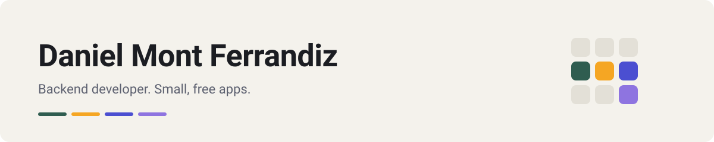

<picture>
  <source media="(prefers-color-scheme: dark)" srcset="banner-dark.svg">
  
</picture>

I'm a backend developer. In my spare time I build small apps for things that I,
or people close to me, needed. Most of them are free and open source, with no ads
and no accounts, and work offline. Mochila is free too, but not open source: it
needs a small server to read school messages.

Away from code, it's mostly home automation. Almost everything at home ends up
going through Home Assistant.

### Apps

<!-- APPS:START -->
<table>
<tr>
<td width="50%" valign="top">
 

  
<b><a href="https://github.com/dferrandizmont/sonoglitch">Sonoglitch</a></b> 
A camera where sound, light and motion distort the photo in real time.  
<a href="https://github.com/dferrandizmont/sonoglitch/releases">Download v0.1.0-alpha.19</a>&nbsp;&nbsp;·&nbsp;&nbsp;<a href="https://github.com/dferrandizmont/sonoglitch">Source</a>
  
</td>
<td width="50%" valign="top">
 

  
<b><a href="https://github.com/dferrandizmont/cuadrante">Cuadrante</a></b> 
Shift calendar for people who work shifts, with your next shift at a glance.  
<a href="https://github.com/dferrandizmont/cuadrante/releases">Download v0.6.12</a>&nbsp;&nbsp;·&nbsp;&nbsp;<a href="https://github.com/dferrandizmont/cuadrante">Source</a>&nbsp;&nbsp;·&nbsp;&nbsp;<a href="https://dferrandizmont.github.io/cuadrante/">Website</a>
  
</td>
</tr>
<tr>
<td width="50%" valign="top">
 

  
<b><a href="https://github.com/dferrandizmont/ley-al-blanco">Ley al Blanco</a></b> 
Study app for Spain's firearms licence theory exam, with all 423 official questions.  
<a href="https://github.com/dferrandizmont/ley-al-blanco/releases">Download v0.9.1</a>&nbsp;&nbsp;·&nbsp;&nbsp;<a href="https://github.com/dferrandizmont/ley-al-blanco">Source</a>
  
</td>
</tr>
</table>
<!-- APPS:END -->

### Stack

&nbsp;&nbsp;&nbsp;
&nbsp;&nbsp;&nbsp;
&nbsp;&nbsp;&nbsp;
&nbsp;&nbsp;&nbsp;
&nbsp;&nbsp;&nbsp;
&nbsp;&nbsp;&nbsp;
&nbsp;&nbsp;&nbsp;
&nbsp;&nbsp;&nbsp;
&nbsp;&nbsp;&nbsp;
&nbsp;&nbsp;&nbsp;
&nbsp;&nbsp;&nbsp;
&nbsp;&nbsp;&nbsp;

### Contact

Found a bug or missing something? Open an issue in the app's repository or write
to [dev@mainshai.com](mailto:dev@mainshai.com).
